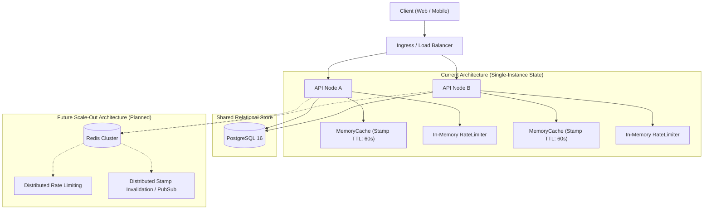

# Architecture Decision Record: ADR-0003

## Authentication, Session Management, and Security Architecture

- **Status**: Accepted
- **Deciders**: Principal .NET Backend Architect, Security Engineer, PostgreSQL Database Architect
- **Date**: 2026-11-18
- **Feature**: FEAT-002 — Authentication
- **Related Documents**:
  - [ADR-0001: Modular Monolith Architecture Pattern](ADR-0001-modular-monolith.md)
  - [ADR-0002: PostgreSQL 16 and EF Core 10 Persistence](ADR-0002-postgresql-efcore.md)
  - [FEAT-002 T1: Security Configuration & Proxy Hardening](../features/FEAT-002-authentication-api-endpoints.md)
  - [FEAT-002 T5: Authentication Application Services](../features/FEAT-002-authentication-application-services.md)
  - [FEAT-002 T6: Authentication API Endpoints](../features/FEAT-002-authentication-api-endpoints.md)
  - [FEAT-002 T7: End-to-End Automated Testing](../features/FEAT-002-authentication-e2e-testing.md)

---

### 1. Context & Architectural Problem

MaintenX is a facility maintenance SaaS platform serving building owners, facility managers, and field technicians via modern web applications (`apps/web` in Next.js) and mobile clients (`apps/mobile` in Flutter). 

The platform requires an authentication, session management, and credential protection subsystem that satisfies the following core architectural requirements:
1. **Multi-Client & Decoupled Frontend Support**: Mobile applications, web SPAs, and internal APIs require stateless API access without relying on browser-centric HTTP cookies or server-rendered session state.
2. **Modular Monolith & DDD Alignment**: In accordance with [ADR-0001](ADR-0001-modular-monolith.md), identity and session models must form an encapsulated bounded context (`MaintenX.Modules.Authentication`) with clear domain aggregates rather than polluting domain models with third-party framework classes.
3. **High Security Standards**: The system must defend against common web application threats, including brute-force attacks, timing attacks, account enumeration, credential stuffing, refresh token theft and replay, session hijacking, and race conditions during token exchange.
4. **Relational Transactional Concurrency**: In accordance with [ADR-0002](ADR-0002-postgresql-efcore.md), state mutations (e.g. login, token rotation, logout, password updates) must leverage PostgreSQL transactional consistency and pessimistic locking (`SELECT ... FOR UPDATE`) to prevent race conditions without introducing complex distributed lock managers.

---

### 2. Decision Drivers

- **Security by Design**: Defense-in-depth across presentation, application, domain, and persistence layers.
- **Stateless Authorization with Immediate Revocation Option**: Balance the performance benefits of stateless JWT access tokens with the security requirement to revoke sessions and rotate compromised credentials.
- **Race Condition Immunity**: Prevent concurrent exchange of a single refresh token from yielding multiple valid child session branches.
- **Operational Simplicity**: Minimize external infrastructure dependencies during early platform stages while documenting explicit paths for horizontal scaling.
- **Zero Information Leakage**: Prevent enumeration of valid usernames or account states via timing discrepancies or differential HTTP status codes.

---

### 3. Historical Accuracy & Evaluated Alternatives

To maintain strict historical fidelity: the specific architectural decisions detailed in Section 4 were planned, implemented, tested, and approved across tasks T1 through T7 of the FEAT-002 feature branch series. The alternative frameworks below were evaluated in relation to these design requirements:

#### Alternative 1: Default ASP.NET Core Identity (`Microsoft.AspNetCore.Identity.EntityFrameworkCore`)
- **Evaluation**: ASP.NET Core Identity provides turn-key user management and cookie-based authentication.
- **Why Rejected**:
  - Heavily opinionated schema (`AspNetUsers`, `AspNetUserClaims`, `AspNetUserRoles`, etc.) that mixes claims, roles, and UI concerns into generic tables, conflicting with our custom Clean Architecture domain model.
  - Tightly coupled to cookie authentication and server-side UI rendering, creating friction for headless mobile (`Flutter`) and decoupled web (`Next.js`) clients.
  - Does not provide native support for cryptographically rotated refresh tokens or PostgreSQL row-level locking out-of-the-box.
  - Exposes sprawling APIs that are difficult to constrain within a strict modular monolith bounded context.
- **Outcome**: **Rejected.**

#### Alternative 2: External Identity Provider / OAuth2 / OIDC SaaS (e.g., Keycloak, Auth0, AWS Cognito, Microsoft Entra ID)
- **Evaluation**: Delegating authentication to an external Identity as a Service (IDaaS) or standalone OIDC server.
- **Why Deferred / Rejected for Baseline**:
  - Introducing an external IDaaS introduces mandatory external network dependencies, recurring cost per active user, or substantial operational overhead (e.g. managing a dedicated Keycloak cluster).
  - MaintenX requires deep relational integration between user identities, tenant provisioning, work order auditing, and custom security audit trails in PostgreSQL.
  - Cross-module transactions (e.g. creating tenant + owner user atomically) become complex distributed sagas when identity lives in an external system.
- **Outcome**: **Rejected for core baseline; the authentication module presents clean interface boundaries (`IAuthenticationService`) so that enterprise federated SSO (SAML/OIDC) can be added cleanly in future features without rewriting application services.**

#### Alternative 3: Custom Domain-Driven Authentication Subsystem with JWT & PostgreSQL Row Locking (Chosen)
- **Evaluation**: Implement a domain-driven authentication bounded context with custom aggregates (`User`, `UserSession`, `RefreshToken`, `SecurityAuditEvent`), ASP.NET Core PBKDF2 password hashing, short-lived JWT access tokens, rotating refresh tokens, and PostgreSQL row-level concurrency control.
- **Outcome**: **Adopted and implemented across FEAT-002 T1–T7.**

---

### 4. Chosen Architecture & Technical Specification

```
┌────────────────────────────────────────────────────────────────────────┐
│                        Presentation Layer                              │
│  - Minimal API Module: /api/v1/auth/{register, login, refresh, ...}    │
│  - ASP.NET Core RateLimiter (Sliding Window per Client IP)             │
│  - ForwardedHeadersOptions (Trusted Reverse Proxy Allowlist)           │
└───────────────────────────────────┬────────────────────────────────────┘
                                    │
                                    ▼
┌────────────────────────────────────────────────────────────────────────┐
│                        Application Layer                               │
│  - IAuthenticationService (Orchestrator)                               │
│  - Out-of-Lock PBKDF2 Password Verification & Precomputed Rehash        │
│  - EF Core Resilient Execution Strategy & Transaction Boundaries       │
│  - SecurityStampValidator (Scoped with In-Memory Cache)                │
└───────────────────────────────────┬────────────────────────────────────┘
                                    │
                                    ▼
┌────────────────────────────────────────────────────────────────────────┐
│                          Domain Layer                                  │
│  - Aggregates: User, UserSession, RefreshToken, SecurityAuditEvent     │
│  - Invariants: Account Lockout, Token Lineage, Status State Machine   │
│  - Redaction: Sensitive Credentials Never Serialized                   │
└───────────────────────────────────┬────────────────────────────────────┘
                                    │
                                    ▼
┌────────────────────────────────────────────────────────────────────────┐
│                     Infrastructure & Persistence                       │
│  - PostgreSQL 16 (platform schema)                                     │
│  - Row-Level Locking: SELECT ... FOR UPDATE                            │
│  - Cryptography: HMAC-SHA256 (JWT), PBKDF2 (Password), SHA-256 (Tokens) │
└────────────────────────────────────────────────────────────────────────┘
```

#### 4.1 Token Lifecycle & Transport
- **Access Tokens (JWT)**:
  - **Lifetime**: 15 minutes (`AccessTokenLifetimeMinutes = 15`).
  - **Algorithm**: HMAC-SHA256 (`HS256`).
  - **Claims**: `sub` (User ID Guid), `sid` (Session ID Guid), `security_stamp` (User Security Stamp string), standard `jti`, `iat`, `exp`, `iss`, `aud`.
  - **Key Ring & Rotation**: Signed using `IJwtKeyRing`, which supports dynamic key retirement and verification of prior keys during a mandatory 24-hour retention window, enabling zero-downtime key rotation.
- **Refresh Tokens**:
  - **Lifetime**: 7 days (`RefreshTokenLifetimeDays = 7`).
  - **Format**: 64-byte cryptographically secure random value (`RandomNumberGenerator`).
  - **Storage**: Raw refresh tokens are **never stored** in the database. Only their cryptographic SHA-256 hash (`byte[32]`) is persisted in `platform.refresh_tokens`.
  - **Transport**: Transferred exclusively via JSON request/response bodies (`RefreshTokenRequest` / `AuthTokenResult`). By avoiding ambient credential transmission (such as automatic cookie attachment on cross-origin requests) and requiring explicit JSON payload submission, this mitigates traditional cookie-based Cross-Site Request Forgery (CSRF) vulnerabilities while providing a uniform, platform-agnostic transport for mobile apps (`Flutter`) and web SPAs (`Next.js`).
- **Sessions (`UserSession`)**:
  - **Absolute Expiration**: 30 days (`SessionAbsoluteLifetimeDays = 30`).
  - Refresh token expirations are strictly bounded by their parent session's `ExpiresAtUtc`. A refresh token cannot extend beyond the 30-day session lifespan.

#### 4.2 Credential Protection & Timing-Attack Defense
- **Hashing Algorithm**: PBKDF2 with HMAC-SHA256 (ASP.NET Core Identity V3 format), 100,000 iterations, 128-bit salt, and 256-bit subkey via ASP.NET Core's default `PasswordHasher<User>`.
- **Transparent Rehash**: When `IPasswordSecurityService.VerifyHashedPassword` signals `SuccessRehashNeeded` (e.g. when iteration counts or hashing algorithms are upgraded), the new hash is precomputed *outside* database locks and updated via `User.RehashPassword(...)`. Transparent rehash updates the password hash without rotating the security stamp, ensuring active user sessions are not prematurely terminated.
- **Timing Discrepancy Elimination**:
  - During registration, candidate password hashing occurs *before* querying candidate email existence in PostgreSQL, ensuring duplicate registration attempts exhibit identical computational latency to new registrations.
  - During login, non-existent user lookups and locked-out account lookups execute dummy PBKDF2 verification (`VerifyDummyPassword`) to present identical computational duration to valid account attempts.
- **Generic Status Codes**:
  - Registration returns a uniform success response regardless of whether an account was newly created or already existed.
  - Login failures—whether caused by invalid password, non-existent account, suspended status, or active lockout—consistently return HTTP `401 Unauthorized` (`INVALID_CREDENTIALS`). HTTP `423 Locked` is intentionally avoided to prevent account enumeration.

#### 4.3 Refresh Token Rotation & Replay Detection
- **Single-Use Rotation**: Exchanging a refresh token atomically revokes the current token, issues a successor child token, updates `UserSession.LastUsedAtUtc`, and generates a fresh 15-minute access JWT.
- **Lineage Tracking**: Each rotated token records its successor via `ReplacedByTokenHash`.
- **Replay Attack Precedence**:
  - During token refresh, checking for replay (`token.IsRotated`) strictly precedes checks for session revocation or expiration.
  - If an already-rotated token is presented, the system assumes token theft and immediately executes **Session Family Revocation**:
    1. The entire parent session is revoked (`SessionRevocationReason.TokenReplayDetected`).
    2. All active refresh tokens belonging to the session are revoked.
    3. An immutable `SecurityAuditEvent` of type `TokenReplayDetected` is committed to PostgreSQL with detected lineage metadata.
    4. If the session was already revoked, its historical revocation reason is preserved, but the security audit event is still recorded.

#### 4.4 PostgreSQL Concurrency & Row Locking
- All state-mutating authentication operations are executed within explicit PostgreSQL `READ COMMITTED` transactions wrapped inside EF Core execution strategies (`strategy.ExecuteAsync(...)`) to ensure automatic resiliency against transient database connection retries.
- Concurrency during token refresh is strictly controlled via parameterized pessimistic row locking:
  ```sql
  SELECT * FROM platform.user_sessions 
  WHERE id = @sessionId 
  FOR UPDATE;
  ```
- **Hierarchical Lock Acquisition**:
  To guarantee zero risk of database deadlocks, lock acquisition strictly follows deterministic ordering:
  $$\text{User} \longrightarrow \text{UserSession} \longrightarrow \text{RefreshToken}$$
- When revoking multiple active sessions during password modification, session row locks are deterministically sorted by primary key (`ORDER BY id FOR UPDATE`).

#### 4.5 Session Revocation & Security Stamp Validation
- **Security Stamp Rotation Triggers**:
  The user entity maintains a `SecurityStamp` string that is mutated exclusively upon critical credential or lifecycle events:
  1. User registration (initial creation).
  2. Password change (`User.UpdatePassword`).
  3. Explicit administrative stamp rotation (`User.RotateSecurityStamp`).
  4. Account suspension (`User.Suspend`).
  5. Account reactivation (`User.Reactivate`).
  6. Account deactivation (`User.Deactivate`).
- **Non-Triggers**:
  - Single session logout (`UserSession.Revoke` / `LogoutAsync`) revokes the specific session and its refresh tokens, but **does not mutate** `User.SecurityStamp`.
  - Transparent password rehash (`User.RehashPassword`) **does not mutate** `User.SecurityStamp`.
- **Validation Pipeline & Caching**:
  - The JWT bearer event `OnTokenValidated` invokes `ISecurityStampValidator.ValidateAsync(userId, securityStamp)`.
  - **In-Memory Cache**: To prevent overwhelming PostgreSQL on every authenticated API request, validated stamps are cached in-memory with a strict **60-second absolute TTL**.
  - **Single-Instance Invalidation**: Local state-mutating operations call `_securityStampValidator.Invalidate(userId)` to clear the local node's cache immediately.
  - **Access Token Invalidation Window**: Because JWT access tokens are stateless, an active access token remains cryptographically valid until:
    1. Its 15-minute expiration timestamp elapses, OR
    2. The security stamp is rotated in the database AND the 60-second cache TTL expires (or is locally invalidated).
    3. *Important*: Single session logout invalidates the refresh token immediately, but does not revoke existing access tokens prior to their 15-minute expiration unless the endpoint explicitly queries session status in the database.

#### 4.6 Rate Limiting & Account Lockout
- **Presentation Layer Rate Limiting**:
  Implemented via ASP.NET Core `RateLimiter` middleware using IP-based sliding-window partitions (`SlidingWindowRateLimiterOptions`) for tracked client IPs, with a 1-permit fixed-window fallback for unresolvable or memory-overflow partitions:
  - `Auth.Registration`: 5 requests per 60 seconds per client IP.
  - `Auth.Login`: 10 requests per 60 seconds per client IP.
  - `Auth.Refresh`: 30 requests per 60 seconds per client IP.
  - Requests exceeding limits return HTTP `429 Too Many Requests` with RFC 7807 Problem Details.
- **Domain Account Lockout**:
  - Tracks consecutive failed attempts in `User.FailedLoginAttempts` over a 15-minute rolling window.
  - 5 consecutive failures automatically engage account lockout (`LockoutEndUtc = now + 15 minutes`).
  - Successful authentication or password update resets the failed attempt counter and clears lockout.

#### 4.7 Security Audit Trail & Retention
- **Audit Persistence**:
  - Security audit events are modeled via `SecurityAuditEvent` and persisted in `platform.security_audit_events`.
  - Maps metadata to PostgreSQL `jsonb` with explicit indexes on `created_at_utc`, `user_id`, and `session_id`.
  - To ensure durability, the table omits cascading foreign keys (`user_id` and `session_id` are unconstrained GUIDs), preventing audit log deletion if user records are removed.
- **Domain-Level Immutability**:
  - Entity immutability is strictly enforced at the domain and application level (private setters, absence of update/delete methods in repositories and application services).
  - *Note*: Physical database-level append-only enforcement (such as PostgreSQL WORM triggers or `REVOKE UPDATE, DELETE`) is not currently active and is documented as a future database hardening item.
- **Persistence vs. Retention Policy**:
  - Audit records persist indefinitely in PostgreSQL by default. An automated data retention purge job (e.g. archiving events older than 1 year to cold storage) is an operational concern and is not implemented in the application codebase.
  - In contrast, cryptographic retired keys in `JwtKeyRing` enforce an automated 24-hour retention window.
- **Audit Data & Sensitive Secret Redaction**:
  - The audit system persists validated client IP addresses (IPv4 or IPv6) for security forensics and operational tracking, but strictly excludes sensitive authentication secrets: plaintext passwords, password hashes, raw tokens, token hashes, or unverified candidate email addresses.

#### 4.8 Reverse Proxy & Forwarded Header Trust
- Configured via `ForwardedHeadersOptions` for `X-Forwarded-For` and `X-Forwarded-Proto`.
- Default ASP.NET Core known proxies and networks are cleared on startup to prevent trusting arbitrary spoofed proxy headers.
- **Fail-Fast Production Safeguard**: `TrustedProxyOptionsValidator` enforces that in Production environments, `TrustedProxies:KnownProxies` or `TrustedProxies:KnownNetworks` cannot be empty. If missing or invalid, application startup aborts immediately.

#### 4.9 Explicit Scope Boundary: Administrative Password Reset
- Application service logic for administrative password reset (`AuthorizedResetPasswordAsync`) exists in `IAuthenticationService`.
- However, exposure of an administrative reset HTTP endpoint is **explicitly deferred** until a trusted Role-Based Access Control (RBAC) model and administrative permission infrastructure are established in FEAT-004.

---

### 5. Multi-Instance Operational Limitations & Future Scale-Out

The current implementation (T1–T7) is optimized for single-instance or vertically scaled deployments. When horizontally scaling the API across multiple container instances behind a load balancer, the following architectural limitations must be addressed:



#### Documented Multi-Node Considerations:
1. **In-Memory Rate Limiting**:
   - The current `RateLimiter` maintains sliding window counters in process memory. In a multi-node cluster, a client's requests distributed across $N$ instances effectively multiply the permitted request threshold by $N$.
   - *Future Consideration*: Implement a distributed rate limiting store (e.g. Redis sliding window or Redis token bucket).
2. **In-Memory Security Stamp Cache**:
   - When a security stamp is rotated on Node A (e.g. password changed), Node A invalidates its local memory cache immediately. However, Node B's local cache may still hold the old valid stamp for up to the remainder of its 60-second TTL.
   - *Future Consideration*: Introduce Redis-backed distributed caching or Redis Pub/Sub backplane to broadcast cache invalidation events across all active API nodes.
3. **Important Distinction**:
   - Redis alone does not solve all distributed security concerns (e.g. clock drift across cluster nodes, database connection exhaustion, or cross-node synchronization of token exchange). Core concurrency control relies on PostgreSQL row-level locks, which remain fully authoritative regardless of cluster size.

---

### 6. Security Implications & Threat Mitigation Matrix

| Threat Category | Attack Vector | Architectural Mitigation in MaintenX |
| :--- | :--- | :--- |
| **Brute Force** | High-frequency password guessing on login | Multi-layered: IP-based sliding rate limiting (10 req/min) + 5-attempt/15-min account lockout. |
| **Credential Stuffing** | Automated submission of leaked credential dumps | PBKDF2 high iteration computation cost + aggressive IP sliding window limits. |
| **Account Enumeration** | Timing discrepancy or differential HTTP errors | Password hashing executed before user check on registration; dummy hashing on login; uniform 401 response for all login failures; generic registration response. |
| **Token Theft & Replay** | Intercepted refresh token reused by attacker | Single-use rotation; SHA-256 token hashing; immediate session family revocation on replay detection. |
| **Session Hijacking** | Access token theft from compromised client | Short 15-minute JWT lifetime; security stamp rotation capability; JSON body transport avoiding ambient credential transmission (cookie CSRF mitigation). |
| **Race Conditions** | Concurrent refresh token exchange | Parameterized PostgreSQL row locks (`SELECT ... FOR UPDATE`) in `READ COMMITTED` transactions. |
| **IP Spoofing** | Forged `X-Forwarded-For` headers bypassing limits | Default proxies cleared; strict production allowlist validation via `TrustedProxyOptionsValidator`. |

---

### 7. Operational Consequences & Trade-offs

#### Positive Consequences:
- **Zero Framework Lock-in**: Clean domain models (`User`, `UserSession`, `RefreshToken`, `SecurityAuditEvent`) free from ASP.NET Core Identity tables and dependencies.
- **Cross-Platform Compatibility**: JSON body refresh token exchange functions seamlessly across Flutter mobile apps and Next.js web frontends.
- **Audit Durability**: Complete non-cascading security audit trail capturing all authentication events with client IP for security forensics, without leaking sensitive credentials or secrets.
- **Predictable Concurrency**: Relational row locks prevent session duplication and token branching without introducing distributed lock managers.

#### Negative Consequences & Mitigations:
- **Database Load on Token Refresh**: Every token refresh requires a transactional database query with row locking. *Mitigation*: 15-minute access token lifetime keeps refresh frequency low (at most 4 requests per hour per active user).
- **Invalidation Window for Access Tokens**: Stateless JWT access tokens remain valid until expiration (up to 15 minutes) or until security stamp cache expiration (up to 60 seconds). *Mitigation*: 15-minute lifetime provides an acceptable security window for standard SaaS workloads; critical operations (e.g. password change) immediately rotate security stamp.
- **Horizontal Scaling Dependency**: Scaling horizontally requires adding Redis for distributed rate limiting and stamp invalidation. *Mitigation*: Clear architectural boundaries enable swapping `RateLimiter` and `ISecurityStampValidator` implementations with zero changes to domain models.

---

### 8. References
- [RFC 7519: JSON Web Token (JWT)](https://datatracker.ietf.org/doc/html/rfc7519)
- [RFC 6749: The OAuth 2.0 Authorization Framework](https://datatracker.ietf.org/doc/html/rfc6749)
- [RFC 7807: Problem Details for HTTP APIs](https://datatracker.ietf.org/doc/html/rfc7807)
- [OWASP Authentication Cheat Sheet](https://cheatsheetseries.owasp.org/cheatsheets/Authentication_Cheat_Sheet.html)
- [OWASP Password Storage Cheat Sheet](https://cheatsheetseries.owasp.org/cheatsheets/Password_Storage_Cheat_Sheet.html)
