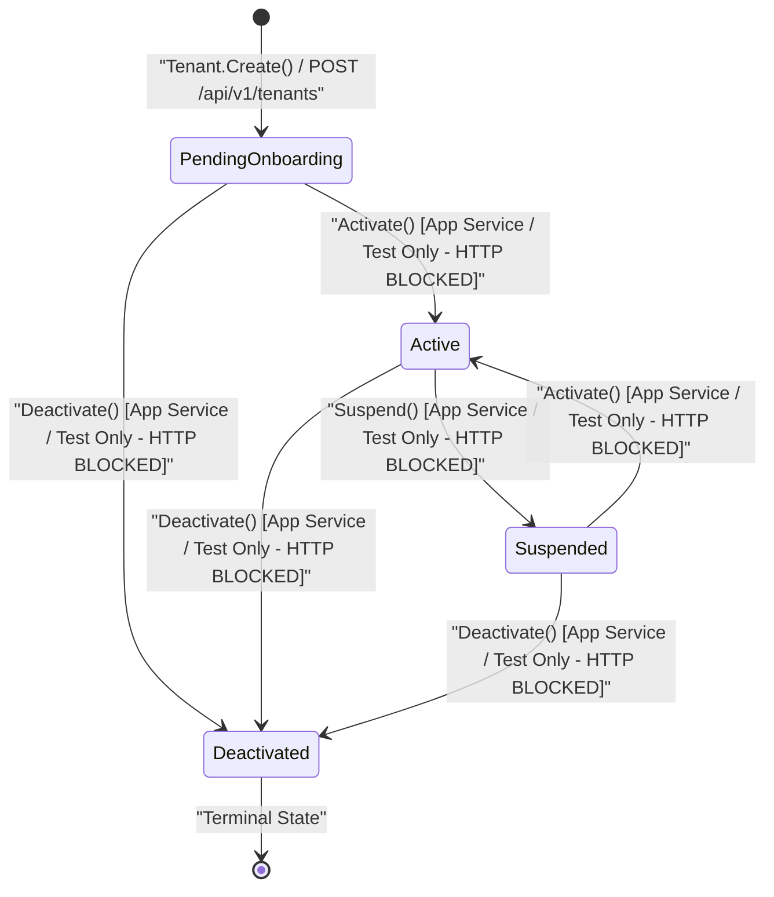
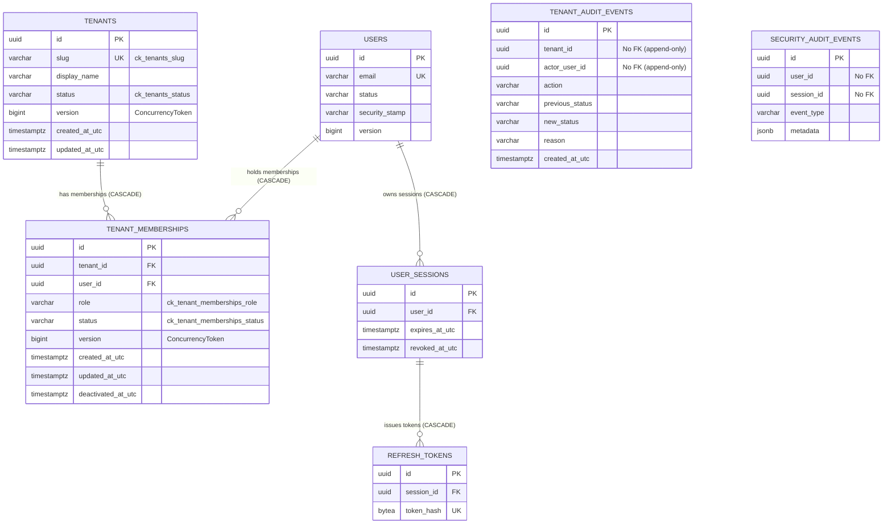
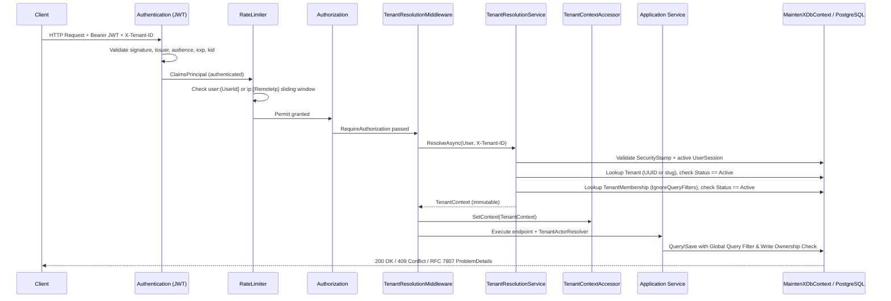
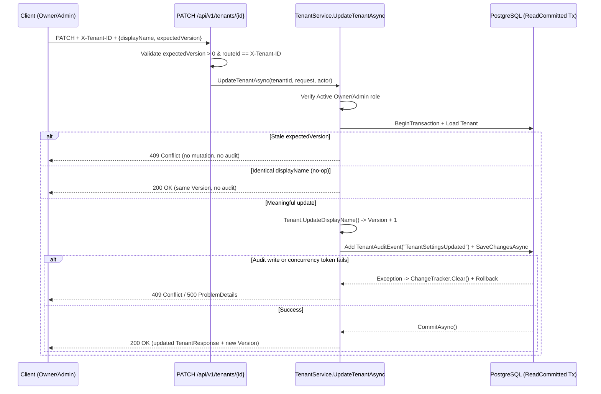

# Architecture Decision Record: ADR-0004

## Multi-Tenancy Architecture, Tenant Context, and Data Isolation

- **Status**: Proposed (Pending Human Review on PR for Step 3.7)
- **Deciders**: Principal Software Architect, Senior .NET 10 Engineer, Enterprise Application Security Architect, PostgreSQL Database Architect
- **Date**: 2026-11-25
- **Feature**: FEAT-003 — Multi-Tenancy Architecture & Management (Tasks 3.1 through 3.7)
- **Related Documents**:
  - [ADR-0001: Modular Monolith Architecture Pattern](ADR-0001-modular-monolith.md)
  - [ADR-0002: PostgreSQL 16 and EF Core 10 Persistence](ADR-0002-postgresql-efcore.md)
  - [ADR-0003: Authentication, Session Management, and Security Architecture](ADR-0003-authentication-security-architecture.md)
  - [FEAT-003 Application Security Verification](../project/FEAT-003-APPLICATION-SECURITY-VERIFICATION.md)
  - [FEAT-003 HTTP API Verification](../project/FEAT-003-HTTP-API-VERIFICATION.md)
  - [FEAT-003 Final Verification](../project/FEAT-003-FINAL-VERIFICATION.md)

---

## 1. Context & Problem Statement

MaintenX is a B2B multi-tenant facility maintenance SaaS platform serving commercial real estate operators, campuses, facility managers, and field technicians. The platform must satisfy the following architectural drivers:

1. **Strict Logical Data Isolation**: Each tenant organization's operational data (and memberships) must be isolated so that no caller can read, modify, or delete data belonging to another organization.
2. **Multi-Organization Users**: One authenticated `User` identity (`platform.users`) may belong to zero, one, or multiple tenant organizations (`platform.tenants`) with distinct per-tenant roles (`Owner`, `Administrator`, `Member`).
3. **Authentication != Tenant Authorization**: Validating a JWT and `UserSession` proves *who* the caller is (established in `FEAT-002`), not *which* organization they are authorized to act within.
4. **Explicit Workspace Selection**: Requests operating within a tenant boundary must explicitly select the target tenant via `X-Tenant-ID` (UUID or normalized slug), never silently defaulting to a "first" membership.
5. **Lifecycle & Membership Governance**: Both `Tenant.Status` (`PendingOnboarding`, `Active`, `Suspended`, `Deactivated`) and `TenantMembership.Status` (`Pending`, `Active`, `Suspended`, `Revoked`) govern operational access.
6. **Separation of Tenant Roles & Platform Administration**: A tenant `Owner` or `Administrator` has authority only within their tenant organization and must never obtain platform-level privileges (`IsPlatformAdmin`).

---

## 2. Architectural Decision

MaintenX adopts a **Shared Application Infrastructure + Shared PostgreSQL Database with Discriminator (`TenantId`) + Request-Scoped Verified Context + EF Core Defense-in-Depth Isolation** model:

1. **Shared PostgreSQL 16 Database (`platform` schema)**:
   - **Global Catalog & Identity Entities**: `Tenant` (`platform.tenants`), `User` (`platform.users`), `UserSession` (`platform.user_sessions`), `RefreshToken` (`platform.refresh_tokens`), `SecurityAuditEvent` (`platform.security_audit_events`), and `TenantAuditEvent` (`platform.tenant_audit_events`).
   - **Tenant-Owned Entities (`ITenantEntity`)**: Implement `Guid TenantId { get; }`. Currently `TenantMembership` (`platform.tenant_memberships`) implements `ITenantEntity`, establishing the pattern for all upcoming business domain entities (`Facilities`, `Assets`, `WorkOrders`, etc.).
2. **Verified Request-Scoped Context (`ITenantContext` / `TenantContextAccessor`)**:
   - `TenantResolutionMiddleware` inspects endpoint metadata (`IRequireTenantContextMetadata` via `.RequireTenantContext()`).
   - `TenantResolutionService` validates JWT authentication, `sub`/`sid`/`sst` claims, `ISecurityStampValidator`, active non-revoked/non-expired `UserSession`, explicit `X-Tenant-ID`, `Tenant.Status == Active`, and `TenantMembership.Status == Active`.
   - `TenantContextAccessor` stores the immutable `TenantContext` for the single HTTP request scope (never persisted across requests).
3. **EF Core Global Query Filters & Write Ownership Validation (`MaintenXDbContext`)**:
   - `ApplyTenantFilters` automatically attaches `HasQueryFilter(e => IsTenantFilterDisabled || (CurrentTenantId.HasValue && (Guid?)e.TenantId == CurrentTenantId))` to every `ITenantEntity` in the model.
   - `SaveChanges` / `SaveChangesAsync` invokes `EnforceTenantOwnershipOnWrite()`, throwing `SecurityException` on missing context, `Guid.Empty`, cross-tenant `Added`/`Modified`/`Deleted`, or `TenantId` reassignment.
4. **Narrow Privileged Bypass Scopes (`CreatePrivilegedTenantBypassScope`)**:
   - Controlled `IDisposable` `TenantBypassScope` reserved strictly for tenant-neutral infrastructure workflows (onboarding, membership discovery, explicit target membership verification), always restoring `_isTenantFilterDisabled` on `Dispose()`.
5. **Trusted Actor Separation (`ITenantActorResolver`)**:
   - `TenantActorResolver` constructs `TenantActorContext` exclusively from server-verified claims/DB session state and hardcodes `IsPlatformAdmin: false` for all HTTP callers.

---

## 3. Alternatives Considered

The following alternatives are evaluated retrospectively against MaintenX's modular monolith (`ADR-0001`) and PostgreSQL/EF Core (`ADR-0002`) foundations:

| Dimension | 1. Shared DB + `TenantId` + EF Filters *(Chosen)* | 2. Separate Schema per Tenant | 3. Separate Database per Tenant |
|---|---|---|---|
| **Operational Complexity** | Low: single connection pool, single schema, standard EF Core migrations | Medium-High: schema-per-tenant connection routing & dynamic `ModelCacheKeyFactory` | High: dynamic connection strings, pool exhaustion, distributed catalog |
| **Migration Complexity** | Single atomic migration pipeline (`MaintenXDbContext`) | Must iterate migrations across $N$ schemas on every deploy | Must orchestrate migrations across $N$ databases with partial-failure risk |
| **Infrastructure Cost** | Lowest: shared PostgreSQL 16 instance | Low-Medium: higher catalog/metadata overhead per schema | Highest: dedicated DB instances/clusters or elastic pools |
| **Security Isolation** | Application + EF Core filters/write guards (requires discipline; not DB-enforced RLS) | Schema search-path isolation (still shares DB superuser/roles unless isolated) | Strongest physical isolation |
| **Performance & Pooling** | Optimal Npgsql connection pooling and shared query plans | Reduced plan sharing across schemas | Connection pool fragmentation across tenants |
| **Backup & Restore** | Simple whole-DB snapshots; point-in-time per-tenant restore requires export | Schema-level `pg_dump` possible | Cleanest per-tenant backup/restore |
| **Scalability & Compliance** | Ideal for SaaS MVP and hundreds/thousands of SMB/mid-market tenants | Struggles beyond ~1,000 schemas in PostgreSQL | Suited for strict single-tenant enterprise compliance tiers |

---

## 4. Consequences & Security Limitations

### 4.1 Positive Consequences
- Zero connection-pool fragmentation and single-command EF Core migrations.
- Automatic fail-closed read filtering and write-ownership validation for every future `ITenantEntity` (`Facilities`, `Assets`, `WorkOrders`) without duplicating `Where(x => x.TenantId == ...)` in every query.
- Clean support for multi-tenant users switching workspaces via `X-Tenant-ID`.

### 4.2 Explicit Security Limitations
1. **Application-Level Isolation != PostgreSQL RLS**: `MaintenXDbContext` query filters and `SaveChanges` guards do **not** protect against `FindAsync` (Wait: in EF Core 10, `FindAsync` bypasses global query filters for already-tracked entities), raw SQL (`ExecuteSqlRaw`), `IgnoreQueryFilters()`, `ExecuteUpdate`, `ExecuteDelete`, or bulk operations. Future hardening may layer PostgreSQL Row-Level Security (RLS) via `SET LOCAL app.current_tenant_id`.
2. **Platform Admin Authorization Blocked (`FEAT-004`)**: No trusted platform administrator identity or JWT role claim exists yet. `IsPlatformAdmin` is hardcoded `false` in `TenantActorResolver`, and `/activate`, `/suspend`, `/deactivate` HTTP routes remain unexposed.
3. **Database-Level Audit Immutability Deferred**: `platform.tenant_audit_events` is append-only in domain/application code, but PostgreSQL role permissions (`REVOKE UPDATE, DELETE`) / immutability triggers are not yet enforced.
4. **Single-Instance Rate Limiting & Stamp Cache**: `RateLimiter` partitions and `SecurityStampValidator` 60s cache are in-memory per node.
5. **Uniform Anti-Enumeration Policy (`TD-09` Resolved)**: Both `GET /api/v1/tenants/{id}` and `TenantResolutionService` (`X-Tenant-ID` middleware) check membership visibility before exposing tenant lifecycle status, returning identical generic `404 Not Found` responses for nonexistent, non-member, and historically revoked-member tenants.

---

## 5. Multi-Tenancy Domain Architecture

### 5.1 Domain Entities & Invariants
- **`Tenant`** (`services/api/Domain/Tenants/Tenant.cs`):
  - `Id` (`Guid`), `Slug` (`string`, 2-100 lowercase alphanumeric + single hyphens), `DisplayName` (`string`, 2-100 trimmed), `Status` (`TenantStatus`), `Version` (`long`, optimistic concurrency token starting at `1`), `CreatedAtUtc`, `UpdatedAtUtc`.
  - Invariants: Created in `PendingOnboarding`; `Deactivated` is terminal; `UpdateDisplayName` rejects `Deactivated` tenants and is idempotent on identical values without bumping `Version`.
- **`TenantMembership`** (`services/api/Domain/Tenants/TenantMembership.cs`, implements `ITenantEntity`):
  - `Id` (`Guid`), `TenantId` (`Guid`), `UserId` (`Guid`), `Role` (`TenantMembershipRole`: `Owner = 1`, `Administrator = 2`, `Member = 3`), `Status` (`TenantMembershipStatus`), `Version` (`long`), `CreatedAtUtc`, `UpdatedAtUtc`, `DeactivatedAtUtc` (`DateTime?`).
  - Invariants: `Revoked` is terminal (`Activate`/`Suspend` throw `InvalidOperationException`); tenant roles are strictly scoped to that `TenantId` (`Owner` != Platform Admin).
- **`TenantAuditEvent`** (`services/api/Domain/Tenants/TenantAuditEvent.cs`):
  - `Id` (`Guid`), `TenantId` (`Guid`), `ActorUserId` (`Guid`), `Action` (`string`, e.g. `TenantActivated`, `TenantSuspended`, `TenantDeactivated`, `TenantSettingsUpdated`), `PreviousStatus` (`string`), `NewStatus` (`string`), `Reason` (`string?`), `CreatedAtUtc` (`DateTime`).

### 5.2 Tenant Lifecycle State Diagram



*Note: Repeated `Activate`, `Suspend`, or `Deactivate` calls in the same state are idempotent no-ops. `PendingOnboarding -> Suspended` throws `InvalidOperationException`. Public HTTP lifecycle endpoints remain unexposed pending `FEAT-004`.*

### 5.3 Membership Lifecycle State Diagram

```mermaid
stateDiagram-v2
    [*] --> Pending : "TenantMembership.Create(..., Pending) [Domain Only]"
    [*] --> Active : "TenantMembership.Create(..., Active) [Onboarding / Seed]"
    Pending --> Active : "Activate() [Domain Only]"
    Pending --> Revoked : "Revoke() [Domain Only]"
    Active --> Suspended : "Suspend() [Domain Only]"
    Active --> Revoked : "Revoke() [Domain Only]"
    Suspended --> Active : "Activate() [Domain Only]"
    Suspended --> Revoked : "Revoke() [Domain Only]"
    Revoked --> [*] : "Terminal State (Historical row preserved; re-invite creates new row)"
```

*Note: Public membership invitation and role-mutation HTTP endpoints do not exist yet (deferred to `FEAT-004`).*

---

## 6. Database Architecture & Migration Inventory

All tables reside in the PostgreSQL 16 `platform` schema:



- **Partial Unique Index on `platform.tenant_memberships`**: `ix_tenant_memberships_tenant_id_user_id_non_revoked` (`UNIQUE (tenant_id, user_id) WHERE status != 'Revoked'`) prevents conflicting active/pending/suspended memberships while preserving historical `Revoked` rows for auditability and clean re-invitation.
- **Audit Tables (`platform.tenant_audit_events`, `platform.security_audit_events`)**: Intentionally omit physical foreign keys to prevent cascading deletes from destroying compliance history.

### Migration Inventory (Applied in Order)
1. `20261113000000_InitialDatabaseFoundation`: Creates `platform` schema and `platform.tenants`.
2. `20261113000001_HardenTenantSlugConstraints`: Adds `ck_tenants_slug` regex and length check constraint.
3. `20261114000000_AddAuthPersistenceEntities`: Adds `platform.users`, `platform.user_sessions`, `platform.refresh_tokens`, `platform.security_audit_events`.
4. `20261123000000_AddTenantMembershipPersistence`: Adds `platform.tenant_memberships`, FKs, check constraints, and `ix_tenant_memberships_tenant_id_user_id_non_revoked`.
5. `20261124000000_AddTenantAuditPersistence`: Adds `platform.tenant_audit_events` with indexes on `tenant_id`, `actor_user_id`, `created_at_utc`.

---

## 7. Request Pipeline, Tenant Context & Workflows

### 7.1 ASP.NET Core Middleware Pipeline Order (`Program.cs` & `SecurityServiceExtensions.cs`)
`UseForwardedHeaders` (`KnownProxies` + `KnownIPNetworks`) -> `UseExceptionHandler` -> `UseSwagger` (Dev only) -> `UseCors` -> `UseAuthentication` -> `UseRateLimiter` -> `UseAuthorization` -> `UseTenantResolution` -> Endpoint Execution.

### 7.2 Tenant-Scoped Request Sequence



### 7.3 Durable Audit & Settings Concurrency Sequence



---

## 8. Privileged Bypass Call-Site Inventory

| Caller | Method | Bypass Reason | Predicate / Restriction |
|---|---|---|---|
| `TenantResolutionService` | `ResolveAsync` | `.IgnoreQueryFilters()` (line 179) | `m.TenantId == tenant.Id && m.UserId == userId` (`AsNoTracking`) |
| `TenantMembershipService` | `GetUserMembershipsAsync` | `CreatePrivilegedTenantBypassScope("query-user-memberships")` | `m.UserId == userId && m.Status != Revoked` (`AsNoTracking`) |
| `TenantMembershipService` | `GetMembershipAsync` | `CreatePrivilegedTenantBypassScope("query-membership")` | `m.TenantId == tenantId && m.UserId == userId` (`AsNoTracking`) |
| `TenantService` | `CreateTenantAsync` | `CreatePrivilegedTenantBypassScope("tenant-onboarding")` | Atomic creation of new `Tenant` + `Owner` `TenantMembership` |
| `TenantService` | `UpdateTenantAsync` | `CreatePrivilegedTenantBypassScope("verify-tenant-update-membership")` | `m.TenantId == tenantId && m.UserId == effectiveActor.UserId && m.Status == Active` (`AsNoTracking`) |
| `TenantService` | `IsActiveTenantMemberAsync` | `CreatePrivilegedTenantBypassScope("verify-tenant-membership")` | `m.TenantId == tenantId && m.UserId == actor.UserId && m.Status == Active` (`AsNoTracking`) |

---

## 9. Verification Reference

- **Build**: `MaintenX.sln` (`Release`, .NET 10 SDK) — **0 Warnings, 0 Errors**.
- **Unit Tests**: **567 Passed, 0 Failed, 0 Skipped**.
- **Integration Tests**: **303 Passed, 0 Failed, 0 Skipped** (PostgreSQL 16).
- **Total Backend Tests**: **870 Passed (100%)**.
- Detailed matrices and HTTP contract examples: [FEAT-003-APPLICATION-SECURITY-VERIFICATION.md](../project/FEAT-003-APPLICATION-SECURITY-VERIFICATION.md) and [FEAT-003-HTTP-API-VERIFICATION.md](../project/FEAT-003-HTTP-API-VERIFICATION.md).
