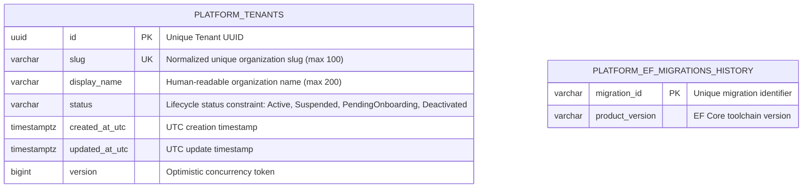

# MaintenX Database Architecture & Persistence Design

## 1. Executive Summary & Philosophy

MaintenX is an enterprise-grade multi-tenant facility maintenance and Computerized Maintenance Management System (CMMS) SaaS platform. The persistence foundation is architected around **PostgreSQL 16** as the definitive source of truth, managed via **Entity Framework Core 10 (EF Core 10 LTS)** following Clean Architecture and Domain-Driven Design (DDD) principles.

The database architecture is designed for:
- Strict relational consistency, transactional integrity, and atomic execution across facility operations.
- Explicit schema segmentation (`platform` vs. domain/tenant schemas).
- Portable UUID primary keys for distributed identification.
- Predictable and auditable optimistic concurrency management.
- Complete defense-in-depth security, credential protection, and strict UTC timestamping.

---

## 2. Relational Entity Relationship Diagram (Initial Foundation)

The foundational ERD defines the root tenant organization catalog stored in the `platform` schema:



---

## 3. Database Naming Conventions

All relational structures adhere to uniform PostgreSQL conventions:

| Element | Format / Case | Example | Description |
|---|---|---|---|
| **Schemas** | `snake_case` | `platform` | Isolated schema boundaries for platform catalog vs. business modules |
| **Tables** | `snake_case` (plural) | `platform.tenants` | Lowercase plural table names |
| **Columns** | `snake_case` | `display_name`, `created_at_utc` | Lowercase snake_case across all columns |
| **Primary Keys** | `pk_{table}` | `pk_tenants` | Explicitly named primary key constraints |
| **Unique Indexes** | `ix_{table}_{column}` | `ix_tenants_slug` | Explicit unique index on normalized slug |
| **Check Constraints**| `ck_{table}_{property}` | `ck_tenants_status` | Database-level domain constraint validation |
| **Foreign Keys** *(Future)* | `fk_{table}_{ref_table}_{col}` | `fk_assets_tenants_tenant_id` | Foreign key constraints targeting root entities |

---

## 4. Entity Model & Schema Definition: `platform.tenants`

The `platform.tenants` table serves as the root tenant directory for the multi-tenant SaaS platform:

```sql
CREATE SCHEMA IF NOT EXISTS platform;

CREATE TABLE platform.tenants (
    id uuid NOT NULL,
    slug character varying(100) NOT NULL,
    display_name character varying(200) NOT NULL,
    status character varying(50) NOT NULL,
    created_at_utc timestamp with time zone NOT NULL,
    updated_at_utc timestamp with time zone NOT NULL,
    version bigint NOT NULL,
    CONSTRAINT pk_tenants PRIMARY KEY (id),
    CONSTRAINT ck_tenants_status CHECK (status IN ('Active', 'Suspended', 'PendingOnboarding', 'Deactivated')),
    CONSTRAINT ck_tenants_slug CHECK (slug ~ '^[a-z0-9]+(-[a-z0-9]+)*$' AND length(slug) >= 2 AND length(slug) <= 100)
);

CREATE UNIQUE INDEX ix_tenants_slug ON platform.tenants (slug);
```

### Field Specifications & Invariants
- **`id` (uuid)**: Client-generated or application-generated RFC 4122 UUID (`Guid.NewGuid()`). Prevents sequential ID guessing and enables distributed offline ID generation.
- **`slug` (varchar(100))**: Unique, normalized lowercase organization identifier (e.g. `acme-facility`, `st-marys-hospital`). Indexed uniquely via `ix_tenants_slug`. Enforced via check constraint `ck_tenants_slug`: lowercase alphanumeric characters and single internal hyphens, length 2 to 100 characters. Rejects whitespace, uppercase letters, leading/trailing hyphens, and symbols at the database engine level.
- **`display_name` (varchar(200))**: Human-readable organizational name.
- **`status` (varchar(50))**: Enforces organizational lifecycle status (`Active`, `Suspended`, `PendingOnboarding`, `Deactivated`) at both the domain model and PostgreSQL constraint levels (`ck_tenants_status`).
- **`created_at_utc` / `updated_at_utc` (timestamptz)**: PostgreSQL `timestamp with time zone`. Automatically updated on persistence changes.
- **`version` (bigint)**: Optimistic concurrency tracking token. Incremented on each update to detect and prevent dirty writes and lost updates.

---

## 5. EF Core 10 Architecture & Dependency Boundaries

To adhere to Modular Monolith and DDD architecture, persistence concerns are isolated:

```
[Domain Model: Tenant, TenantStatus]
       ▲
       │ Depends only on core C# types (Zero framework references)
       │
[Infrastructure: MaintenXDbContext, TenantConfiguration, Migrations]
       ▲
       │ Implements persistence via Microsoft.EntityFrameworkCore 10 & Npgsql 10
       │
[Application / Host API: Program.cs, Services]
       │
       └── Configures DI via AddMaintenXPersistence(configuration)
```

### EF Core 10 Design Decisions
1. **No Generic Repository Wrappers**: Avoids redundant abstractions over `DbContext` and `DbSet<T>`, which are already unit-of-work and repository patterns.
2. **Entity Configuration Discovery**: Uses `modelBuilder.ApplyConfigurationsFromAssembly(typeof(MaintenXDbContext).Assembly)` to automatically register modular entity mappings.
3. **Controlled Connection Resiliency**: Configured with `EnableRetryOnFailure(maxRetryCount: 5, maxRetryDelay: 10s)` to tolerate transient connection blips gracefully.
4. **Design-Time Factory**: `MaintenXDesignTimeDbContextFactory` allows `dotnet-ef` CLI tooling to generate migrations safely outside the running application host.

---

## 6. Migration & Deployment Strategy

1. **Code-First Schema Migrations**:
   - Schema definitions originate from EF Core migration classes committed to Git in `services/api/Infrastructure/Persistence/Migrations/`.
   - Migration history is tracked in `platform."__EFMigrationsHistory"`.
2. **Prohibition of Production Auto-Migration**:
   - `Database.Migrate()` is **never** executed automatically during production API startup.
   - Prevents race conditions, distributed deadlocks during rolling deploys, and unreviewed schema mutations.
3. **Idempotent Migration Scripts**:
   - Every migration is also compiled into a verified idempotent SQL script (`docs/migrations/0001_initial_database_foundation.sql`).
   - Suitable for reviewed CI/CD delivery pipelines and DB administrator review.

---

## 7. Optimistic Concurrency Management

MaintenX implements an optimistic concurrency strategy using an explicit `version` column (`bigint`):

1. **Token Mapping**: Configured via `builder.Property(t => t.Version).IsConcurrencyToken()`.
2. **Mutation Handling**: On `DbContext.SaveChangesAsync()`, the `ChangeTracker` increments `entry.Entity.Version += 1`.
3. **Conflict Detection**: EF Core generates SQL updates with `WHERE id = @id AND version = @original_version`. If a concurrent transaction modified the row, 0 rows are affected and EF Core throws `DbUpdateConcurrencyException`.
4. **Client Recovery**: Application callers catch `DbUpdateConcurrencyException` and report a safe conflict response (HTTP 409 Conflict) allowing the client to reload and resolve differences.

---

## 8. UTC Timestamp Invariants

- All datetime properties are typed as `DateTime` with `DateTimeKind.Utc`.
- Mapped to PostgreSQL `timestamp with time zone` (`timestamptz`).
- EF Core automatically verifies and applies `DateTime.UtcNow` in `SaveChangesAsync`.
- Integration test `DB007_UtcTimestamps_RoundTripCorrectly` verifies exact round-trip preservation.

---

## 9. Security & Credential Protection

- **No Secrets in Source Control**: Connection strings are omitted from shared base `appsettings.json`. Values are resolved strictly from environment variables (`ConnectionStrings__DefaultConnection`) or .NET User Secrets (`dotnet user-secrets set "ConnectionStrings:DefaultConnection" "..."`).
- **Fail-Fast Configuration**: `MaintenXDesignTimeDbContextFactory` and `DatabaseServiceExtensions` strictly throw an `InvalidOperationException` if a connection string is absent, removing all hardcoded credential fallbacks.
- **Genuine Role Separation & Secure Container Initialization**:
  - **Cluster Administrator (`postgres`)**: Holds `SUPERUSER` and `CREATEDB` privileges, used exclusively via `ConnectionStrings:AdminConnection` to provision and drop isolated databases.
  - **Application Role (`maintenx_app`)**: Restricted role with `NOSUPERUSER`, `NOCREATEDB`, and `NOCREATEROLE`. When an isolated database is provisioned, ownership is assigned to `maintenx_app` (`CREATE DATABASE ... OWNER "maintenx_app"`). Migrations and data operations execute under this restricted role.
  - **Secure Initialization Script (`01-init-roles.sh`)**: Executable script executed by the official PostgreSQL entrypoint on fresh volumes. Validates `POSTGRES_APP_USER` and `POSTGRES_APP_DB` against `^[a-zA-Z_][a-zA-Z0-9_]{0,62}$` before executing SQL, passes credentials safely via psql's `\getenv` and `format(%I, %L)`, completely avoids string interpolation in SQL heredocs, and never logs passwords.
- **Sanitized Driver Exception Testing**: Integration test `DB012` verifies that low-level ADO.NET / Npgsql driver exceptions do not reflect or format plaintext credentials in message payloads.
- **Sanitized Public API Response Testing**: Integration test `DB013` executes against `/health/ready` under simulated database failure to prove that public HTTP Problem Details and Health JSON payloads contain zero connection strings, credentials, hostnames, ports, or internal exception stack traces.

---

## 10. Automated Testing & Database Isolation Strategy

To ensure zero risk of data loss or schema pollution on developer (`maintenx_dev`), staging, or production databases:
1. **Isolated Disposable Test Databases**:
   - Each integration test execution dynamically creates an isolated database: `maintenx_test_{Guid:N}`.
   - Migrations are applied exclusively to this disposable test database.
   - At completion of the test suite (`DisposeAsync`), the test database is completely dropped (`DROP DATABASE ... WITH (FORCE)`).
2. **Strict Guard Rails & Host Allowlisting**:
   - Safety guard `TestDatabaseGuard` enforces explicit opt-in: `TestDatabase:AllowProvisioning=true`. If not set, tests fail closed.
   - Requires explicit `ConnectionStrings:AdminConnection` and `ConnectionStrings:TestConnection`. Refuses to fall back to `DefaultConnection`.
   - Host allowlist verification: `TestDatabase:AllowedHosts` is mandatory and fails closed if missing or empty. Both admin and test connections must point to explicitly allowlisted test hosts. Unapproved, remote, or production hosts are rejected immediately.
   - Name verification: database names must start strictly with `maintenx_test_`.
   - Protected databases: explicitly forbids mutation or destruction of protected databases (`maintenx_dev`, `maintenx_prod`, `maintenx_staging`, `postgres`, `template0`, `template1`), throwing an `InvalidOperationException` if violated.
   - Factory disposal and teardown resilience: `_isolatedFactory` is disposed in `try/finally` even if database teardown encounters an error, teardown errors are logged to `stderr` and rethrown, and integration test `DB020` proves that any initialization failure after DB creation triggers immediate emergency DROP DATABASE and surfaces the error to the test runner.
3. **Additive Migration Strategy**:
   - Schema modifications are delivered via additive migrations (`20261113000000_InitialDatabaseFoundation`, followed by `20261113000001_HardenTenantSlugConstraints`).
   - Prevents destructive schema rewrites or loss of existing migration history on existing developer environments.

---

## 11. Future Multi-Tenant Isolation Strategy (Roadmap for FEAT-003)

While `FEAT-001` delivers the root tenant catalogue table (`platform.tenants`), future business tables (Facilities, Assets, Work Orders) will implement row-level multi-tenancy:
- **`tenant_id` (uuid)**: Foreign key referencing `platform.tenants(id)` on every tenant-owned resource.
- **Global Query Filters**: `builder.HasQueryFilter(e => e.TenantId == _tenantProvider.TenantId)`.
- **Soft Deletion**: `is_deleted (boolean)` and `deleted_at_utc (timestamptz)` filtered automatically.
- **Strict Prohibition**: Tenant isolation is explicitly **planned for FEAT-003** and is not claimed as operational in FEAT-001.

---

## 12. Known Limitations & Rollback Procedures

- **Rollback Limitations**: Rolling back initial migrations in production drops tables and destroys tenant data. Prior to applying migrations in production, automated physical backups (WAL archives and snapshots) must be verified.
- **Local Toolchain Execution**: On environments without the .NET 10 SDK installed locally, migrations and integration tests run inside Docker containers or GitHub Actions CI runners.
