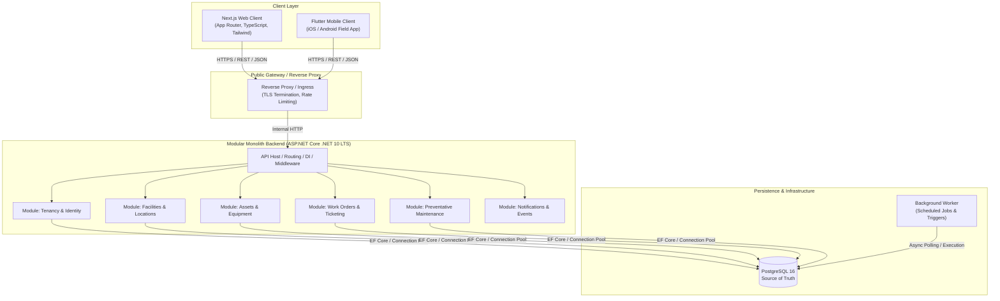

# MaintenX System Architecture Overview

## 1. Executive Summary

MaintenX is an enterprise-grade multi-tenant facility maintenance SaaS platform designed to streamline work order management, asset tracking, maintenance scheduling, and real-time vendor collaboration. The system is engineered around a **Modular Monolith** architecture pattern, governed by Domain-Driven Design (DDD) and Clean Architecture principles.

---

## 2. System Context & Communication Topology



---

## 3. Architecture Justification: Why Modular Monolith?

MaintenX deliberately adopts a **Modular Monolith** architecture over microservices for several core reasons:

1. **Transactional Integrity & Consistency**: Facility maintenance domain invariants (e.g. assigning work orders to specific assets located in verified facility zones under an active tenant license) require strict relational integrity, atomic transactions, and ACID guarantees provided by PostgreSQL.
2. **Operational Simplicity**: Avoids distributed system pitfalls (distributed tracing overhead, network partitions, multi-service deployments, eventual consistency complexities) during foundational growth.
3. **Strict Domain Encapsulation**: Each domain module maintains its own Clean Architecture boundaries (Domain, Application, Infrastructure, Presentation) and exposes explicit interfaces (`IModule`). Modules do not query other modules' internal database tables directly; communication occurs via public domain interfaces or in-process domain events.
4. **Future Microservices Optionality**: Because module boundaries are strictly decoupled and domain-oriented, high-volume modules (e.g. IoT asset telemetry or real-time notification dispatches) can be extracted into standalone services if and when independent scaling demands it.

---

## 4. Planned Domain Module Boundaries

| Module | Core Responsibility | Key Entities |
|---|---|---|
| **Tenancy** | Organization provisioning, tenant isolation, subscription plans, users, roles & permissions. | `Tenant`, `User`, `Role`, `TenantSubscription` |
| **Facilities** | Multi-tier campus, building, floor, room, and zone management. | `Facility`, `Building`, `Floor`, `Zone` |
| **Assets** | Equipment catalog, serial tracking, warranty, maintenance logs, QR code generation. | `Asset`, `AssetCategory`, `WarrantyInfo` |
| **WorkOrders** | Reactive maintenance ticketing, priority assignment, SLA tracking, status workflows. | `WorkOrder`, `WorkOrderItem`, `TicketComment`, `LaborLog` |
| **MaintenanceSchedules** | Preventative & recurring maintenance calendars, automated ticket triggers. | `MaintenanceSchedule`, `RecurrenceRule`, `Checklist` |
| **Notifications** | Multi-channel dispatch (email, SMS, push) to technicians and property managers. | `NotificationTemplate`, `NotificationLog` |

---

## 5. Dependency Direction & Layering Rules

Each module strictly follows Clean Architecture:

```
[Presentation / API Controllers]
       │
       ▼
[Application Services / MediatR Handlers / DTOs]
       │
       ▼
[Domain Model / Aggregates / Value Objects / Domain Events]
       ▲
       │
[Infrastructure / EF Core DbContexts / External Adapters]
```

- **Domain Layer**: Has zero external package dependencies. Represents enterprise business rules.
- **Application Layer**: Orchestrates use cases, commands, and queries.
- **Infrastructure Layer**: Implements persistence via Entity Framework Core and PostgreSQL.
- **Presentation Layer**: Exposes strongly typed HTTP endpoints adhering to `/api/v{version}/{module}/{resource}` conventions.

---

## 6. Multi-Tenant Isolation Strategy

MaintenX enforces a **Shared Database, Separate Schemas / Row-Level Tenant Isolation** strategy:
- Every tenant-owned entity implements `ITenantEntity` with a required `TenantId (Guid)`.
- Global query filters in EF Core automatically enforce `WHERE TenantId = @CurrentTenantId` on all database reads and writes.
- Tenant ID is resolved securely from authenticated claims (JWT token claims) and verified server-side. Client-supplied tenant IDs are never trusted alone.

---

## 7. Development & Deployment Topology

- **Local Development**:
  - PostgreSQL container running via Docker Compose (`docker-compose up -d postgres`)
  - ASP.NET Core API running locally or containerized on port `5000`
  - Next.js web application running locally on port `3000`
  - Flutter mobile client running on Android/iOS emulators or devices
- **Production Deployment**:
  - Managed PostgreSQL instance with automated backups and read-replicas
  - Containerized ASP.NET Core API deployment running on Linux containers
  - Next.js deployed via Node.js container or edge infrastructure
  - Automated CI/CD pipeline via GitHub Actions for building, testing, linting, and vulnerability scanning.
