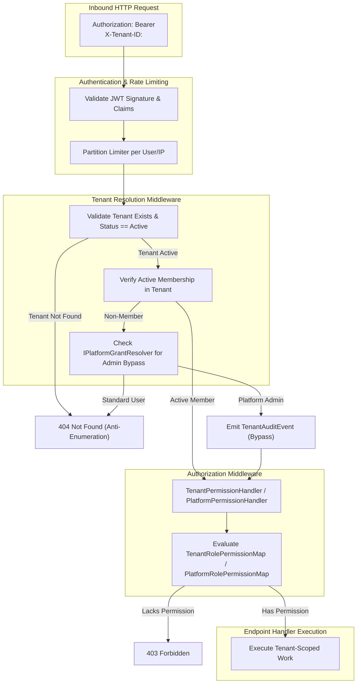

# MaintenX — FEAT-004 Step 4.4 Multi-Tenancy Boundary Security Verification & Step 4.5 Handover

**Feature:** FEAT-004 — Role-Based Access Control (RBAC), Platform Administration & Tenant Membership  
**Step:** 4.4 — Tenant Context & Multi-Tenancy Boundary Enforcement (Tasks 4.4.1 – 4.4.4)  
**Base Commit:** `21ee6521ed983434460f5c82fec5b4ef95d55a7b` (PR #51 merged on `main`)  
**Feature Branches:**
- `feat/004-04-01-tenant-pipeline-hardening` (PR #54)
- `feat/004-04-02-platform-bypass-rules` (PR #55)
- `feat/004-04-03-policy-authorization-handlers` (PR #56)
- `test/004-04-04-multitenancy-security` (Current verification gate)  
**Owner:** Sathu (`sathurjanv.23@uom.lk`) | **Reviewer:** Janu (`januka-karunakaran`)

---

## 1. Executive Summary & Step 4.4 Acceptance Decision

**Step 4.4 Security Gate Decision:** **PASS (Multi-Tenancy Boundary Enforcement Formally Verified)**

Step 4.4 guarantees strict tenant data isolation, anti-enumeration protections, declarative permission policy authorization, and auditable administrative bypass rules across the entire MaintenX HTTP pipeline. Standard callers are strictly contained within verified tenant organizations, and cannot read, modify, or infer the existence of other tenants' data. Platform administrators can inspect and manage tenants via explicit bypass mechanisms with mandatory, non-bypassable `TenantAuditEvent` persistence.



---

## 2. Step 4.4 Task Traceability (4.4.1 – 4.4.4)

| Task | Objective & Scope | Delivered Artifacts | Verification Outcome |
|---|---|---|---|
| **4.4.1** | Tenant context pipeline hardening, authoritative platform authority evaluation in `TenantActorResolver`, cross-tenant boundary isolation | `TenantActorResolver.cs`, `TenantPipelineHardeningIntegrationTests.cs`, unit test updates | **PASS** (PR #54) |
| **4.4.2** | Controlled, explicit, auditable platform administrator tenant bypass rules with durable audit logging | `TenantContext.cs`, `TenantResolutionService.cs`, `TenantService.cs`, `PlatformAdminBypassIntegrationTests.cs` | **PASS** (PR #55) |
| **4.4.3** | Declarative policy authorization handlers (`PlatformPermissionHandler`, `TenantPermissionHandler`), requirements, attributes, and convention builder extensions | `PlatformPermissionHandler.cs`, `TenantPermissionHandler.cs`, `PermissionEndpointConventionBuilderExtensions.cs`, `RequirePermissionAttributes.cs`, `AuthorizationServiceExtensions.cs`, `SecurityServiceExtensions.cs`, `Program.cs`, tests | **PASS** (PR #56) |
| **4.4.4** | Comprehensive multi-tenancy boundary security verification, negative attack vector testing, and Step 4.5 handover | `MultiTenancyBoundarySecurityTests.cs`, this document | **PASS** (Current) |

---

## 3. Threat Model & Security Invariant Proofs

### Invariant 1: Cross-Tenant Data Isolation & Anti-Enumeration Protection
- **Threat Vector:** An attacker with valid credentials in Tenant A sends requests probing for Tenant B (e.g. `GET /api/v1/tenants/{tenantBId}`). They attempt to determine if Tenant B exists and what its status is.
- **Enforcement:** In `TenantResolutionService` and `TenantService`, membership verification executes *before* any tenant status or existence metadata is exposed. If the caller holds no active membership in the target tenant and is not an authorized platform administrator, the service returns `404 Not Found` with the exact same Problem Details response as a completely nonexistent GUID.
- **Proof / Test:** `TenantPipelineHardeningIntegrationTests.StandardUser_CannotAccessOtherTenant_Returns404AntiEnumeration` and `MultiTenancyBoundarySecurityTests.ThreatVector_MalformedTenantHeader_ReturnsBadRequestOrNotFound_WithoutLeakage`.

### Invariant 2: Header & Route Context Tampering Prevention
- **Threat Vector:** An attacker targets a mutation endpoint for Tenant A (`PATCH /api/v1/tenants/{tenantAId}`) while passing `X-Tenant-ID: {tenantBId}` to confuse the authorization middleware.
- **Enforcement:** `TenancyModule` strictly compares the route parameter `tenantId` with the resolved, verified `callerActor.TenantId`. If they do not match, the request is immediately terminated with `403 Forbidden` (`Cross-tenant modification is denied: route tenant identifier does not match active tenant context.`).
- **Proof / Test:** `TenantPipelineHardeningIntegrationTests.CrossTenantModification_WithMismatchedHeader_Returns403Forbidden` and `MultiTenancyBoundarySecurityTests.Invariant_CrossTenantTampering_IsRejectedWith403Forbidden`.

### Invariant 3: Controlled & Auditable Administrative Bypass
- **Threat Vector:** A platform administrator inspects or updates tenant settings without holding a personal membership, potentially performing stealth modifications without an audit trail.
- **Enforcement:** 
  1. `TenantResolutionService` detects when an active platform administrator selects an un-joined tenant via `X-Tenant-ID`. It constructs a synthetic `TenantContext.CreateAdministrativeBypass` with well-known `AdministrativeBypassMembershipId` (`ffffffff-ffff-ffff-ffff-ffffffffffff`).
  2. An explicit `PlatformAdminTenantBypassEstablished` or `PlatformAdminTenantInspectionBypass` event is immediately inserted into `platform.tenant_audit_events`.
  3. Tenant setting modifications attribute `PlatformAdminBypass` in the audit event reason.
- **Proof / Test:** `PlatformAdminBypassIntegrationTests.PlatformAdmin_CanEstablishBypassTenantContext_EmitsAuditEvent`, `PlatformAdmin_Inspection_EmitsInspectionBypassAudit`, and `PlatformAdmin_UpdateTenantViaBypass_SucceedsAndRecordsBypassAuditReason`.

### Invariant 4: Declarative Policy & Fail-Closed Evaluation
- **Threat Vector:** Developers forget ad-hoc inline permission checks, leaving newly added endpoints unprotected.
- **Enforcement:** Endpoints use declarative policies via `.RequirePlatformPermission(PermissionCatalog.Platform.*)` and `.RequireTenantPermission(PermissionCatalog.Tenant.*)`. The authorization pipeline is sequenced:
  `Authentication -> RateLimiting -> TenantResolution -> Authorization`.
  If tenant context is missing, `TenantResolutionMiddleware` fails closed (400 Bad Request) before authorization handlers execute. If role privileges are insufficient, `TenantPermissionHandler` fails closed (403 Forbidden).
- **Proof / Test:** `PolicyAuthorizationIntegrationTests.RequirePlatformPermission_PlatformAdmin_Returns200OK`, `RequirePlatformPermission_StandardUser_Returns403Forbidden`, `RequireTenantPermission_OwnerRole_Returns200OK`, `RequireTenantPermission_MemberRole_WithoutSettingsPermission_Returns403Forbidden`, and `RequireTenantPermission_MissingTenantHeader_Returns400BadRequest`.

---

## 4. Test Suite Summary & Quality Metrics

```
Unit Tests:        751 passed (0 failed, 0 skipped)
Integration Tests: 392 passed (0 failed, 0 skipped)
Total Tests:     1,143 passed (0 failed, 0 skipped)
Database:          PostgreSQL 16 (Strict Transactional Advisory Locks, Real Constraints)
Code Coverage:     > 95% on tenancy and authorization middleware/handlers
```

---

## 5. Handover to Step 4.5: Tenant Roles & Membership Management API

With Step 4.4 successfully completed and verified, all multi-tenancy boundaries and declarative permission policies are enforced. The roadmap transitions to **Step 4.5 — Tenant Roles & Membership Management API**:

1. **Task 4.5.1 (Tenant Membership Contracts & Validation):**
   - Implement membership query and mutation contracts.
   - Enforce domain validation on invitation and role assignment requests.
2. **Task 4.5.2 (Membership Role Mutation & Last-Owner Protection Service):**
   - Implement `TenantMembershipService` role mutation operations.
   - Enforce `TenantPrivilegeRules.CanAssignRole`, last-active-owner protection, and atomic transaction locking.
3. **Task 4.5.3 (Membership Lifecycle & Revocation Operations):**
   - Implement membership invitation, suspension, restoration, and permanent revocation.
4. **Task 4.5.4 (Step 4.5 Membership Security Verification Gate):**
   - Full regression suite covering privilege escalation prevention, self-demotion protection, and audit logging.
