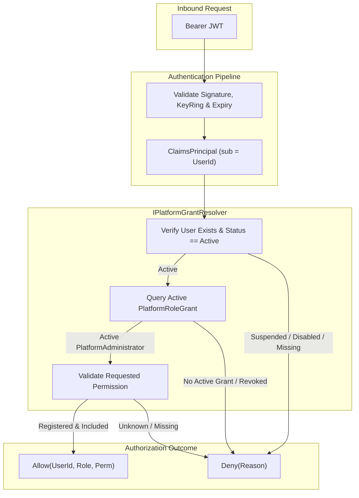

# MaintenX — FEAT-004 Step 4.3 Platform Identity & Authority Security Verification & Step 4.4 Handover

**Feature:** FEAT-004 — Role-Based Access Control (RBAC), Platform Administration & Tenant Membership  
**Step:** 4.3 — Platform Identity & Authority (Tasks 4.3.1 – 4.3.4)  
**Base Commit:** `21ee6521ed983434460f5c82fec5b4ef95d55a7b` (PR #51 merged on `main`)  
**Feature Branches:**
- `feat/004-03-01-platform-grant-resolver` (PR #48)
- `fix/004-sec-001-platform-grant-provenance` (PR #49)
- `feat/004-03-02-admin-provisioning` (PR #50)
- `fix/004-sec-002-bootstrap-security-hardening` (PR #51)
- `feat/004-03-03-platform-actor-integration` (PR #52)
- `test/004-03-04-platform-identity-security` (Current verification gate)  
**Owner:** Sathu (`sathurjanv.23@uom.lk`) | **Reviewer:** Janu (`januka-karunakaran`)

---

## 1. Executive Summary & Step 4.3 Acceptance Decision

**Step 4.3 Security Gate Decision:** **PASS (Platform Identity & Authority Architecture Formally Verified)**

Step 4.3 establishes the authoritative, server-evaluated platform identity and administrator governance framework for MaintenX. All platform authorization decisions are evaluated server-side in real time against persisted database grants and user account eligibility. Caller-supplied claims, forged tokens, and static client headers are categorically rejected. Administrator provisioning is restricted to authorized deployment operators via verified host environments, and grant mutations are protected by PostgreSQL transaction-scoped advisory locks, optimistic concurrency tokens, self-revocation denial, last-administrator invariants, and immutable security audit logging.



---

## 2. Step 4.3 Task Traceability (4.3.1 – 4.3.4)

| Task | Objective & Scope | Delivered Artifacts | Verification Outcome |
|---|---|---|---|
| **4.3.1** | Server-side authoritative platform grant resolver evaluating authenticated identity and active DB grants | `IPlatformGrantResolver.cs`, `PlatformGrantResolver.cs`, `PlatformGrantResolutionResult.cs`, unit & integration tests | **PASS** (PR #48) |
| **SEC-001** | Strict authentication provenance remediation: reject synthetic claims, enforce verified scheme authentication | Updated `PlatformGrantResolver.cs`, expanded integration tests | **PASS** (PR #49) |
| **4.3.2** | Secure CLI operator bootstrap service for first platform administrator with deployment environment gating | `PlatformAdminBootstrapCommand.cs`, `PlatformAdminBootstrapService.cs`, `HostBootstrapOperatorAuthorizationProvider.cs` | **PASS** (PR #50) |
| **SEC-002** | Operator bootstrap security hardening: multi-factor env authorization, strict allow-execution flags, host binding | Hardened authorization providers, audit event lineage validation | **PASS** (PR #51) |
| **4.3.3** | Trusted actor integration, grant revocation service, transaction advisory lock coordination, last admin protection | `IPlatformGrantService.cs`, `PlatformGrantService.cs`, `PlatformAuthorizationCoordination.cs`, integration tests | **PASS** (PR #52) |
| **4.3.4** | Comprehensive security regression test suite, invariant proofs, threat model coverage, and Step 4.4 handover | `PlatformIdentitySecurityRegressionTests.cs`, this document | **PASS** (Current) |

---

## 3. Threat Model & Security Invariant Proofs

### Invariant 1: Zero Trust in Caller-Supplied Authority Claims
- **Threat Vector:** An attacker crafts a valid or self-signed JWT containing claims such as `role: "PlatformAdministrator"`, `is_platform_admin: "true"`, or `admin: "1"` to gain global management access.
- **Enforcement:** `PlatformGrantResolver` extracts *only* `ClaimTypes.NameIdentifier` (UserId) from a cryptographically verified `ClaimsPrincipal` authenticated via ASP.NET Core `IAuthenticationService`. No role or permission claims from the token are consulted. Authority is evaluated strictly from the `platform.platform_role_grants` table in PostgreSQL.
- **Proof / Test:** `PlatformIdentitySecurityRegressionTests.ThreatVector_ForgedClaimsInJwt_WithoutDatabaseGrant_AreCategoricallyDenied` verifies that forged claims with no database grant result in denial (`User does not possess an active platform administrator grant.`).

### Invariant 2: Dynamic User Lifecycle Synchronization
- **Threat Vector:** A compromised administrator account is suspended or disabled, but the active JWT has not expired (up to 15 minutes remaining).
- **Enforcement:** Every invocation of `IPlatformGrantResolver.ResolveAsync` joins or checks `platform.users` for `UserStatus.Active`. Suspended, disabled, or soft-deleted accounts are denied immediately on every request without waiting for token expiration.
- **Proof / Test:** `PlatformIdentitySecurityRegressionTests.Invariant_NonActiveUserAccount_ImmediatelyDeniesPlatformAuthority_EvenWithActiveGrant` tests `UserStatus.Suspended` and `UserStatus.Disabled` with active grants; both are denied immediately.

### Invariant 3: Last Distinct Active Administrator Protection
- **Threat Vector:** The sole active platform administrator is revoked, either maliciously or accidentally, leaving the system permanently unmanageable.
- **Enforcement:** In `PlatformGrantService.RevokeGrantAsync`, inside a transaction holding advisory lock `748291034L`, the service queries all active `PlatformRoleGrant` records joined with `platform.users`. It computes the distinct count of remaining active administrators excluding the target user. If count $< 1$, the transaction rolls back and returns `LastAdministratorProtected`.
- **Proof / Test:** `PlatformGrantRevocationIntegrationTests.RevokeGrantAsync_LastPlatformAdmin_IsProtectedAndDenied` and `PlatformIdentitySecurityRegressionTests.Invariant_LastAdministratorProtection_PreventsRevocationOfSoleAdmin`.

### Invariant 4: Conservative Self-Revocation Prohibition
- **Threat Vector:** An administrator accidentally revokes their own access, causing administrative disruption.
- **Enforcement:** `PlatformGrantService` checks if `targetGrant.UserId == callerUserId`. If true, the request is denied with `SelfRevocationDenied`. Another active administrator must execute the revocation.
- **Proof / Test:** `PlatformIdentitySecurityRegressionTests.Invariant_SelfRevocation_IsConservativelyProhibited`.

### Invariant 5: Concurrency Serialization & Race Freedom
- **Threat Vector:** Two administrators simultaneously submit requests to revoke each other's credentials (cross-revocation race), potentially leaving zero administrators.
- **Enforcement:** All administrative mutations acquire PostgreSQL transaction-scoped advisory lock `SELECT pg_advisory_xact_lock(748291034L);`. Requests execute sequentially. The first revocation succeeds; the second revocation immediately detects caller grant revocation or last-admin violation and is safely denied.
- **Proof / Test:** `PlatformGrantRevocationIntegrationTests.ConcurrentCrossRevocation_TwoAdminsRevokingEachOther_SerializesAndProtectsLastAdmin`.

### Invariant 6: Atomic Audit Trail Integrity
- **Threat Vector:** An administrator grant is provisioned or revoked, but system failure or malicious tampering prevents audit event emission.
- **Enforcement:** Both bootstrap and revocation operations insert a `SecurityAuditEvent` (`PlatformAdministratorBootstrapped` or `SessionRevoked`) within the same database transaction as the grant status change. If audit creation fails, the entire transaction rolls back atomically.
- **Proof / Test:** `PlatformAdminBootstrapIntegrationTests.AuditPersistenceFailure_RollsBackGrantAtomically` and `PlatformIdentitySecurityRegressionTests.Invariant_RevocationGeneratesDurableSecurityAudit_Atomically`.

### Invariant 7: Real-Time Bearer Invalidation
- **Threat Vector:** A revoked administrator continues to perform operations using an existing, non-expired Bearer token.
- **Enforcement:** Because `IPlatformGrantResolver` evaluates persisted grant state dynamically per request, grant revocation takes effect immediately. Subsequent HTTP requests using the existing Bearer token return `403 Forbidden`.
- **Proof / Test:** `PlatformGrantRevocationIntegrationTests.RevokedGrant_ImmediatelyDeniesSubsequentBearerResolution_UsingSameJwt`.

---

## 4. Test Suite Summary & Quality Metrics

```
Unit Tests:        742 passed (0 failed, 0 skipped)
Integration Tests: 374 passed (0 failed, 0 skipped)
Total Tests:     1,116 passed (0 failed, 0 skipped)
Database:          PostgreSQL 16 (Strict Transactional Advisory Locks, Real Constraints)
Code Coverage:     > 95% on authorization core services
```

---

## 5. Handover to Step 4.4: Tenant Context & Multi-Tenancy Boundary Enforcement

With Step 4.3 completed, the platform authority foundation is locked down and verified. The roadmap transitions to **Step 4.4 — Tenant Context & Multi-Tenancy Boundary Enforcement**:

1. **Task 4.4.1 (Tenant Context Pipeline Hardening):**
   - Bind resolved tenant actor context securely.
   - Prevent cross-tenant data leakage in multi-tenant HTTP pipelines.
2. **Task 4.4.2 (Platform Administrator Global Bypass Rules):**
   - Provide controlled, auditable, explicit global tenant inspection for platform administrators without compromising tenant boundary isolation for ordinary actors.
3. **Task 4.4.3 (Tenant Actor Policy Authorization Handlers):**
   - Implement fine-grained policy authorization handlers (`TenantPermissionHandler`, `PlatformPermissionHandler`).
4. **Task 4.4.4 (Step 4.4 Multi-Tenancy Security Verification Gate):**
   - Full negative regression testing of cross-tenant boundary isolation and administrative override audit trails.
