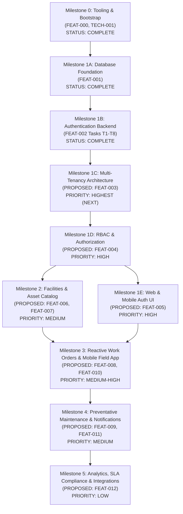

# MaintenX — Master Feature Roadmap & Requirements Matrix

**Document ID:** MASTER-FEATURE-ROADMAP
**Audit Reference:** PROJECT-AUDIT-001
**Audit Date:** 2026-11-23
**Auditor Roles:** Senior .NET Software Architect, Technical Project Manager, Security Engineer
**Repository:** `Sathurjanv23/-MaintenX`
**Base Commit:** `b88748ed07c7f7bc19a1cf6ffae1c238b77626ad`

---

## 1. Specification Baseline & Limitations

### 1.1 Requirements Source & Traceability
- **Primary Committed Specification**: [docs/srs/srs-overview.md](../srs/srs-overview.md) detailing high-level requirements (FR-01 through FR-06, NFR-01 through NFR-04), supported by [System Architecture Overview](../architecture/overview.md), [Database Design](../architecture/database-design.md), and Architecture Decision Records ([ADR-0001](../adr/ADR-0001-modular-monolith.md), [ADR-0002](../adr/ADR-0002-postgresql-efcore.md), [ADR-0003](../adr/ADR-0003-authentication-security-architecture.md)).
- **External Document Limitation**: The file `MaintenX_SRS_and_Architecture_v1.docx` referenced in project briefs is **not present in the repository or local filesystem**. All requirements below are derived strictly from committed Markdown specifications, actual repository code, schema constraints, and verified development history.
- **Future Feature ID Convention**: To maintain historical integrity, feature identifiers `FEAT-000`, `TECH-001`, `FEAT-001`, and `FEAT-002` reflect approved, merged tasks. Proposed future identifiers (`FEAT-003` through `FEAT-012`) are explicitly designated as proposed roadmap milestones.

---

## 2. Requirements Completion Matrix

### 2.1 Functional Requirements (FR)

| Req ID | Requirement Name | Scope & Detailed Description | Mapped Feature | Status | Realized Implementation vs Gaps |
| :---: | :--- | :--- | :---: | :---: | :--- |
| **FR-001** | Tenant Provisioning & Organization Lifecycle | Provision tenant entities, configure subscription tiers, assign administrative owners, and manage tenant lifecycle states (`Active`, `Suspended`, `Terminated`). | FEAT-001 / *FEAT-003* | **PARTIAL** | **Backend**: `platform.tenants` table, `Tenant` root entity, slug constraints, optimistic concurrency. **Gaps**: Tenant onboarding application services, administrative tenant APIs, Next.js tenant portal. |
| **FR-002** | Multi-Tenant Data Isolation & Scoped Queries | Guarantee strict tenant isolation on all business domain read/write queries via contextual tenant filters, preventing cross-tenant data leakage. | *FEAT-003* | **PARTIAL** | **Backend**: `ITenantEntity` interface in `Domain/Tenants/ITenantEntity.cs`. **Gaps**: Tenant resolution middleware, `ITenantContextAccessor`, EF Core global query filters (`WHERE TenantId = @id`). |
| **FR-003** | User Registration & Credential Lifecycle | Secure onboarding of user identities, validation of password complexity (&ge; 12 chars), PBKDF2 credential hashing, transparent rehash, and password change. | FEAT-002 | **PARTIAL** | **Backend**: **COMPLETE** (`POST /api/v1/auth/register`, `POST /api/v1/auth/change-password`, PBKDF2 HMAC-SHA256). **Gaps**: Web frontend and mobile registration UI. |
| **FR-004** | User Authentication & Session Management | Authenticate credentials, issue short-lived JWT access tokens (15m) and rotating refresh tokens (7d), enforce rolling lockout (5 attempts / 15m), and handle session revocation. | FEAT-002 | **PARTIAL** | **Backend**: **COMPLETE** (`POST /api/v1/auth/login`, `POST /api/v1/auth/refresh`, `POST /api/v1/auth/logout`, row locking, replay protection). **Gaps**: Web and mobile login screens. |
| **FR-005** | Role-Based Access Control (RBAC) & Permissions | Assign roles (SuperAdmin, TenantAdmin, FacilityManager, Technician, Occupant) and validate fine-grained permissions on protected API routes. | *FEAT-004* | **NOT STARTED** | **Backend**: Tenant/User schemas ready; role entities, permission claims, and authorization policies not yet built. **Gaps**: Entire RBAC module. |
| **FR-006** | Security Audit Trail & Event Logging | Persist append-only security logs for authentication, lockout, token rotation, and credential mutations with client IP tracking and zero secret leakage. | FEAT-002 | **COMPLETE** *(Backend)* | **Backend**: **COMPLETE** (`platform.security_audit_events` with JSONB metadata, non-cascading durability, client IP normalization). **Gaps**: Audit log viewer UI. |
| **FR-007** | Facility Spatial Hierarchy | Manage physical facilities across a hierarchical structure: Campus &rarr; Building &rarr; Floor &rarr; Zone/Room with GPS coordinates, floor plans, and area boundaries. | *FEAT-006* | **NOT STARTED** | **Backend/UI**: Planned as `MaintenX.Modules.Facilities`. No code or database tables exist. |
| **FR-008** | Equipment Asset Catalog & Lifecycle Tracking | Maintain comprehensive inventory of equipment assets, serial numbers, manufacturers, installation dates, warranty expirations, and replacement costs. | *FEAT-007* | **NOT STARTED** | **Backend/UI**: Planned as `MaintenX.Modules.Assets`. No code or database tables exist. |
| **FR-009** | Asset QR Code & Mobile Tagging | Generate unique QR codes / barcodes for equipment assets allowing mobile field technicians to instantly retrieve asset maintenance history upon scanning. | *FEAT-007* | **NOT STARTED** | **Backend/Mobile**: Planned for mobile technician workflows. |
| **FR-010** | Preventative Maintenance Scheduling | Define calendar-based (daily, weekly, monthly, annual) and runtime threshold recurrence rules for automated equipment inspections and servicing. | *FEAT-009* | **NOT STARTED** | **Backend/Worker**: Planned for `MaintenX.Modules.MaintenanceSchedules` and background worker execution. |
| **FR-011** | Automated Work Order Generation | Trigger automated maintenance tickets from preventative schedule engines, assigning default technician teams, checklists, and safety guidelines. | *FEAT-009* | **NOT STARTED** | **Backend/Worker**: Depends on FR-010 and work order engine. |
| **FR-012** | Reactive Maintenance Request Intake | Allow facility occupants and property managers to submit maintenance requests with priority levels, categorization, location tags, and initial descriptions. | *FEAT-008* | **NOT STARTED** | **Backend/UI**: Planned as `MaintenX.Modules.WorkOrders`. |
| **FR-013** | Work Order Triage, Priority & SLA Tracking | Triage submitted maintenance tickets, assign priority (Low, Medium, High, Emergency), configure SLA countdown timers, and track resolution compliance. | *FEAT-008* | **NOT STARTED** | **Backend/UI**: Core reactive ticketing workflows. |
| **FR-014** | Technician Dispatch & Work Order Assignment | Assign work orders to internal technicians or external maintenance contractors based on specialty, trade, availability, and facility location. | *FEAT-008* | **NOT STARTED** | **Backend/UI**: Planned work order dispatch module. |
| **FR-015** | Mobile Work Order Execution & Offline Caching | Enable mobile field technicians to view assigned tickets, transition statuses (Accepted, In Progress, On Hold, Completed), and operate offline in remote mechanical rooms. | *FEAT-010* | **NOT STARTED** | **Mobile**: Core field app capabilities. |
| **FR-016** | Parts Inventory & Labor Logging | Record labor hours, technician overtime, parts consumed from inventory, and contractor invoices against specific work orders. | *FEAT-008* | **NOT STARTED** | **Backend/UI**: Maintenance costing and asset expenditure tracking. |
| **FR-017** | Photo Attachments & Sign-off Capture | Capture before/after digital photos and customer signature sign-offs on mobile devices upon work order resolution. | *FEAT-010* | **NOT STARTED** | **Mobile**: Field verification attachments. |
| **FR-018** | Multi-Channel Notifications Dispatch | Dispatch real-time notifications (push notifications to mobile, SMS alerts for emergency tickets, email summaries) on critical status transitions. | *FEAT-011* | **NOT STARTED** | **Backend/Worker**: Planned as `MaintenX.Modules.Notifications`. |
| **FR-019** | Facility Analytics & Executive Dashboard | Aggregate key operational metrics: Mean Time to Repair (MTTR), SLA compliance percentages, open ticket backlogs, and equipment breakdown rates. | *FEAT-012* | **NOT STARTED** | **Web**: Planned executive analytics suite. |
| **FR-020** | Maintenance Budgeting & Cost Tracking | Track operational expenditure (OPEX) and capital expenditure (CAPEX) per facility, campus, and asset category against allocated tenant budgets. | *FEAT-012* | **NOT STARTED** | **Web**: Advanced financial tracking. |
| **FR-021** | Vendor & Contractor Collaboration Portal | Enable external maintenance vendors to view assigned contracts, submit quotes, schedule technician visits, and invoice for completed repairs. | *FEAT-012* | **NOT STARTED** | **Web**: Contractor portal. |
| **FR-022** | Compliance Reporting & Audit Data Export | Generate exportable compliance reports (PDF/Excel) for regulatory inspections, safety audits, and insurance certification. | *FEAT-012* | **NOT STARTED** | **Backend/Web**: Reporting subsystem. |

---

### 2.2 Non-Functional Requirements (NFR)

| Req ID | Requirement Name | Approved Target Standard | Verified State | Audit Finding |
| :---: | :--- | :--- | :---: | :--- |
| **NFR-001** | Multi-Tenant Data Isolation | Zero cross-tenant data leakage across all read/write queries | **PARTIAL** | Database schema segmentation and `ITenantEntity` exist; EF Core global query filters and middleware context resolution pending in FEAT-003. |
| **NFR-002** | Cryptographic Protection | PBKDF2 password hashing (&ge; 100k iterations), HMAC-SHA256 JWTs, SHA-256 token hashing | **COMPLETE** | Fully implemented in `PasswordSecurityService`, `JwtTokenService`, and `RefreshTokenService`. Verified by 100+ tests. |
| **NFR-003** | Rate Limiting & DoS Defense | Sliding-window IP limits (Register: 5/min, Login: 10/min, Refresh: 30/min) returning 429 Problem Details | **COMPLETE** | Fully implemented via ASP.NET Core `RateLimiter` middleware with memory-bounded tracking. Verified by integration tests. |
| **NFR-004** | Audit Trail Integrity | Append-only security audit events with client IP tracking and strict secret redaction | **COMPLETE** | Implemented via `platform.security_audit_events`. Verified by unit and integration tests. |
| **NFR-005** | High Availability & Observability | 99.9% availability with automated health checks (`/health/live`, `/health/ready`) | **COMPLETE** | Shallow and deep health probes configured with safe error redaction. |
| **NFR-006** | Sub-200ms API Latency | p95 response time &lt; 200ms for standard database queries | **VERIFIED** | Integration test suite execution confirms fast query performance with PostgreSQL connection pooling. |
| **NFR-007** | Concurrency Control | Zero race conditions on concurrent token exchange or session invalidation | **COMPLETE** | Pessimistic row-level locking (`SELECT ... FOR UPDATE`) in `READ COMMITTED` transactions prevents concurrent branching. |
| **NFR-008** | Cross-Platform Client Support | Responsive Next.js web application and Flutter mobile app | **PARTIAL** | Toolchain, scaffold, and CI verification complete; actual UI features remain in bootstrap state. |
| **NFR-009** | Mobile Offline Resiliency | Field technicians can execute work orders without active cellular connectivity | **NOT STARTED** | Planned for Flutter offline sync milestone. |
| **NFR-010** | Zero-Downtime Key Rotation | Rotate JWT signing keys without invalidating active tokens | **COMPLETE** | Implemented via `IJwtKeyRing` supporting retired verification keys with mandatory 24h retention. |
| **NFR-011** | Secure Reverse Proxy Trust | Prevent IP spoofing through strict production allowlist validation | **COMPLETE** | Implemented via `TrustedProxyOptionsValidator` with fail-fast production startup validation. |
| **NFR-012** | Automated CI/CD & Security Audit | Continuous build, automated lint, unit/integration testing, and dependency vulnerability scanning | **COMPLETE** | Fully configured in GitHub Actions (`.github/workflows/ci.yml`). 506 tests passing in CI. |

---

## 3. Release Milestones & Recommended Implementation Order

### Detailed Milestone Breakdown

#### Milestone 1: Core Foundation & Identity Platform (Current Horizon)
1. **FEAT-003: Multi-Tenancy Architecture & Management (RECOMMENDED NEXT)**
   - *Dependencies*: FEAT-001, FEAT-002.
   - *Scope*: Tenant resolution middleware (subdomain/header/JWT claim), `ITenantContextAccessor`, EF Core global query filters (`WHERE TenantId = @id`), tenant onboarding service, and administrative tenant management API endpoints.
   - *Acceptance Criteria*: Every entity implementing `ITenantEntity` is automatically filtered; cross-tenant query injection is rejected; tenant context is established from authenticated JWT claims.
2. **FEAT-004: Role-Based Access Control (RBAC) & Administrative Authorization**
   - *Dependencies*: FEAT-002, FEAT-003.
   - *Scope*: Define `Role` and `Permission` entities, assign roles per tenant, implement ASP.NET Core authorization policies (`[Authorize(Policy = "Permissions.WorkOrders.Create")]`), expose administrative password reset endpoint (`AuthorizedResetPasswordAsync`).
   - *Acceptance Criteria*: Role-based permissions enforced across Minimal API endpoints; administrative password reset endpoint secured by verified Admin permission.
3. **FEAT-005: Next.js Web Authentication UI & Session Client**
   - *Dependencies*: FEAT-002, FEAT-004.
   - *Scope*: Auth pages in `apps/web` (Register, Login, Change Password, Forgot Password), HTTP client token refresh interceptor (handling 401 and silent refresh via `/api/v1/auth/refresh`), session state management, protected route guards.
   - *Acceptance Criteria*: Users can register, log in, store access JWT in memory, silently rotate refresh tokens, and log out with complete UI state clearance.

#### Milestone 2: Spatial Hierarchy & Equipment Asset Management
4. **FEAT-006: Facility Spatial Hierarchy (`MaintenX.Modules.Facilities`)**
   - *Scope*: Campus, Building, Floor, Room/Zone models, spatial GPS coordinates, CRUD APIs, location picker UI.
5. **FEAT-007: Asset Catalog & Equipment Lifecycle (`MaintenX.Modules.Assets`)**
   - *Scope*: Equipment asset models, serial numbers, warranty tracking, maintenance history, QR code generation.

#### Milestone 3: Reactive Work Orders & Mobile Field Execution
6. **FEAT-008: Reactive Work Order Management (`MaintenX.Modules.WorkOrders`)**
   - *Scope*: Work order intake, triage workflows, priority levels, labor/parts logging, SLA timer tracking.
7. **FEAT-010: Flutter Mobile Technician Field App**
   - *Scope*: Mobile authentication, secure token storage, technician task dashboard, offline work order execution, camera attachment capture, digital customer sign-off.

#### Milestone 4: Preventative Maintenance & Dispatch
8. **FEAT-009: Preventative Maintenance Scheduling & Recurrence Engine**
   - *Scope*: Time/runtime recurrence rules, automated ticket triggers, background worker job scheduling.
9. **FEAT-011: Multi-Channel Notifications Dispatch (`MaintenX.Modules.Notifications`)**
   - *Scope*: Background worker dispatch for email, SMS, and push notifications on critical ticket events.

#### Milestone 5: Executive Analytics & Enterprise Integrations
10. **FEAT-012: Analytics, SLA Reporting & Vendor Portal**
    - *Scope*: MTTR/SLA compliance dashboards, budget/cost tracking, vendor collaboration portal, data export.
